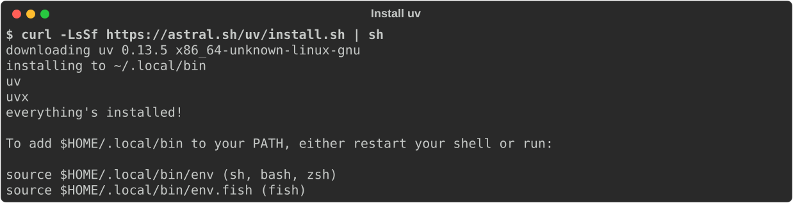
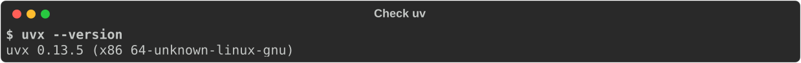
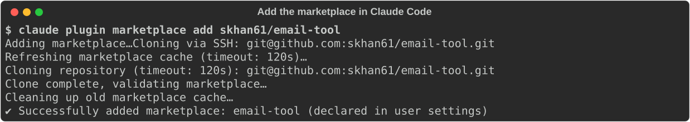
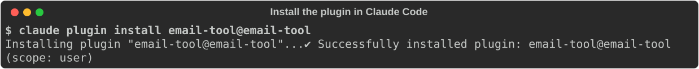

# Install

!!! tip "Not a developer?"
    [Start here](start.md) has the simplest steps for every app, with no terminal.

For other apps, installing takes two parts: the **uv** tool, which runs email-tool, and the
connection to your AI app. Then ask your assistant to "add my mailbox".

**ChatGPT desktop, no typing:** download
[Install-email-tool.cmd](https://github.com/skhan61/email-tool/releases/latest/download/Install-email-tool.cmd)
(Windows) and open it, or
[Install-email-tool-macOS.zip](https://github.com/skhan61/email-tool/releases/latest/download/Install-email-tool-macOS.zip)
(macOS), open the zip, then right-click **Install-email-tool.command** and select **Open**
(macOS asks once because the file comes from the internet). It installs uv and tells you the
next steps in ChatGPT. Otherwise, follow Step 1 below.

## Step 1: Install uv

uv is a free tool from Astral that downloads and runs Python programs. You install it once.

=== "Windows"

    Open **PowerShell** and run:

    ```powershell
    powershell -ExecutionPolicy ByPass -c "irm https://astral.sh/uv/install.ps1 | iex"
    ```

=== "macOS"

    Open **Terminal** and run:

    ```bash
    curl -LsSf https://astral.sh/uv/install.sh | sh
    ```

=== "Linux"

    Open a terminal and run:

    ```bash
    curl -LsSf https://astral.sh/uv/install.sh | sh
    ```

The installer ends with **everything's installed!**:



Close and reopen the terminal, then check that it works:

```bash
uvx --version
```



If the terminal says it cannot find `uvx` (`command not found`, or on Windows
`The term 'uvx' is not recognized`), it has not picked up the new folder yet. Close every
terminal window and open a new one. On macOS and Linux you can instead run
`source $HOME/.local/bin/env` in the open terminal (`source $HOME/.local/bin/env.fish` in fish).

!!! note "Desktop apps on macOS"
    Apps you open from the Dock do not see your terminal's settings, so they may not find
    `uvx`. Where a step below asks for the full path, run `which uvx` and use what it prints,
    usually `/Users/<you>/.local/bin/uvx`.

## Step 2: Connect your AI app

=== "Claude Code"

    1. In a terminal, add the email-tool marketplace:

        ```bash
        claude plugin marketplace add skhan61/email-tool
        ```

        

    2. Install the plugin:

        ```bash
        claude plugin install email-tool@email-tool
        ```

        

    3. Close Claude Code and open it again. The email tools load only when Claude Code starts.

    You can also type the same two commands inside Claude Code, as
    `/plugin marketplace add skhan61/email-tool` and `/plugin install email-tool@email-tool`.
    The plugin also adds the `/inbox`, `/email-search` and `/email-send` commands.

=== "Claude Desktop and Cowork"

    **Option A: the bundle**

    1. Download `email-tool-<version>.mcpb` from the
       [latest release](https://github.com/skhan61/email-tool/releases/latest).
    2. Open the file. Claude Desktop shows an install window.
    3. Select **Install**. Leave the mailbox fields blank to use the mailboxes you add in
       [Add your mailboxes](mailboxes.md), or fill in one mailbox there.

    **Option B: the config file**

    1. In Claude Desktop, select **Settings** > **Developer** > **Edit Config**.
    2. Add this server, then save and restart Claude Desktop:

        ```json
        {
          "mcpServers": {
            "email": {
              "command": "uvx",
              "args": ["--from", "git+https://github.com/skhan61/email-tool", "email-tool-mcp", "serve"]
            }
          }
        }
        ```

    On macOS, replace `uvx` with its full path. Claude Cowork uses the servers Claude Desktop
    runs, so it needs nothing more.

=== "ChatGPT desktop and Codex"

    **In the ChatGPT desktop app:** select **Plugins** > **Add Marketplace**, enter
    `skhan61/email-tool`, then install **email-tool**.

    **In a terminal (Codex CLI):**

    ```bash
    codex plugin marketplace add skhan61/email-tool
    codex plugin add email-tool@email-tool
    ```

    If the email tools do not appear on macOS, add the server by hand in
    `~/.codex/config.toml`, with the full path to `uvx`:

    ```toml
    [mcp_servers.email]
    command = "/Users/you/.local/bin/uvx"
    args = ["--from", "git+https://github.com/skhan61/email-tool", "email-tool-mcp", "serve"]
    ```

    Local tools work in ChatGPT's **Work** and **Codex** modes. Normal **Chat** does not
    reach them yet ([openai/codex#38162](https://github.com/openai/codex/issues/38162)).

=== "ChatGPT Business and Enterprise"

    OpenAI's [Secure MCP Tunnel](https://github.com/openai/tunnel-client) carries ChatGPT's
    requests to email-tool on your computer over an outbound connection. No port is opened,
    and your passwords stay in your keyring.

    1. At platform.openai.com, select **Settings** > **Tunnels** and create a tunnel for
       your ChatGPT workspace. You need the **Tunnels Manage** role.
    2. On your computer, run:

        ```bash
        tunnel-client init --sample sample_mcp_stdio_local --profile email \
          --tunnel-id <tunnel_id> \
          --mcp-command "uvx --from git+https://github.com/skhan61/email-tool email-tool-mcp serve"
        tunnel-client run --profile email
        ```

    3. In ChatGPT, select **Settings** > **Connectors** > **Add**, choose
       **Connection: Tunnel**, and pick your tunnel.

    !!! warning
        While `tunnel-client run` is running, the connector can read, send and delete mail
        in every mailbox you added. Do not share the connector with other workspace members,
        and stop the tunnel when you finish.

=== "Any other MCP app"

    Add a local (stdio) server that runs this command:

    ```bash
    uvx --from git+https://github.com/skhan61/email-tool email-tool-mcp serve
    ```

## Step 3: Add your mailboxes

Continue with [Add your mailboxes](mailboxes.md).

## Update or remove

- **Update a plugin:** update email-tool from your app's plugin manager when a new version
  is released.
- **Update a config-file setup:** run this once, then restart your app:

    ```bash
    uvx --refresh --from git+https://github.com/skhan61/email-tool email-tool-mcp --help
    ```
- **Remove a mailbox:** `email-tool-mcp remove <name>` deletes its settings and its password
  or sign-in.
- **Remove email-tool:** remove the plugin or the server entry from your app, then remove
  each mailbox as above.
