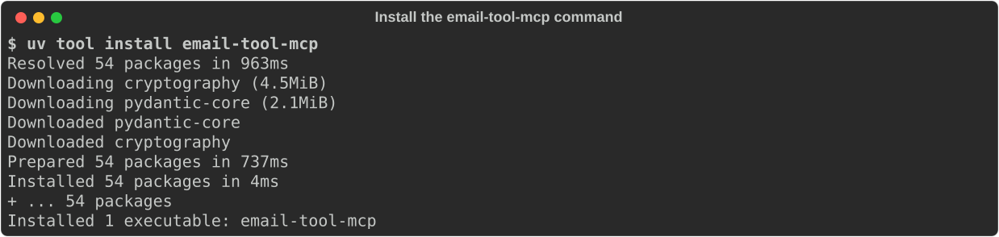
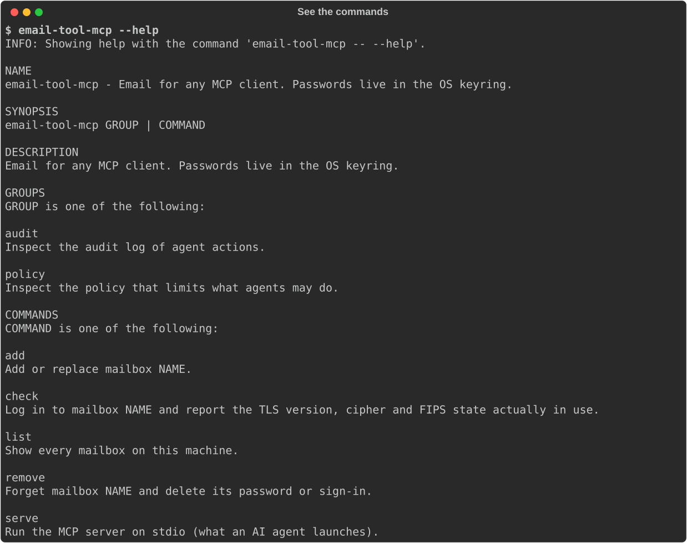
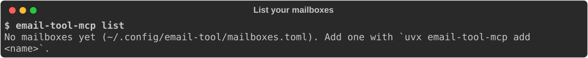
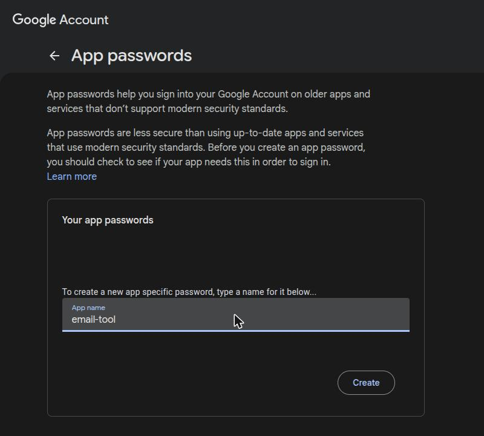
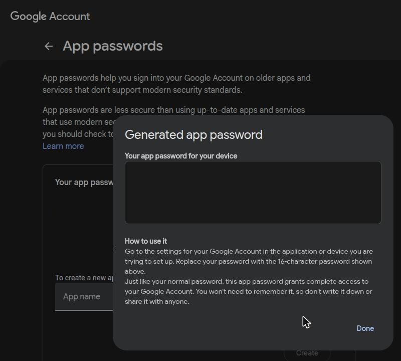
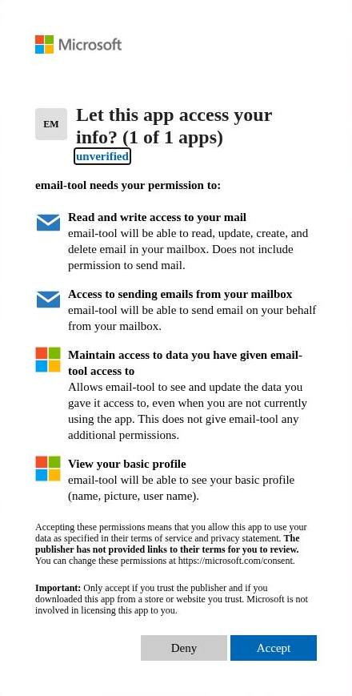

# Add your mailboxes

You add each mailbox once on each computer. email-tool checks that it can both read and
send before it saves anything, so a typo never leaves a half-working mailbox behind.

## Before you start

1. Install the `email-tool-mcp` command once:

    ```bash
    uv tool install git+https://github.com/skhan61/email-tool
    ```

    It ends with **Installed 1 executable: email-tool-mcp**:

    

2. Check that the command works:

    ```bash
    email-tool-mcp --help
    ```

    You see every command, such as **add**, **check** and **list**. If the help fills the
    window, scroll with the arrow keys and press **q** to close it:

    

    If you see `email-tool-mcp: command not found`, close the terminal and open a new one.

3. List your mailboxes. On a new computer there are none yet:

    ```bash
    email-tool-mcp list
    ```

    

Each mailbox gets a short **name** you choose, such as `work` or `personal`. You use that
name when you talk to your assistant ("check my work inbox").

## Which account do I have?

| Your account | Section |
|---|---|
| Your own domain or a hosting company (cPanel, Fastmail and others) | [Password](#password) |
| Gmail (an address ending in `@gmail.com`) | [Gmail](#gmail) |
| Outlook.com, Hotmail or Live | [Microsoft](#microsoft) |
| Microsoft 365 at a company, school or any organization | [Microsoft](#microsoft) |
| Microsoft 365 GCC High | [GCC High](#gcc-high) |
| Google Workspace at a company, school or any organization | [Google Workspace](#google-workspace) |

Not sure? Ask your IT department, or look up your domain's mail records at
[mxtoolbox.com](https://mxtoolbox.com/): `google.com` means Google and `outlook.com` means
Microsoft.

## Password

For mail hosted with your own domain or a hosting company.

1. Find the IMAP and SMTP server names in your provider's help pages or your mail app's
   settings, for example `mail.example.com`.
2. Run:

    ```bash
    email-tool-mcp add work
    ```

3. Enter your address, the IMAP server, the SMTP server, and your password when asked.
   The password is hidden as you type.

The password goes into your operating system's keyring (Windows Credential Manager, macOS
Keychain or GNOME Keyring). To use other ports, add `--imap-port 993 --smtp-port 587`.

## Gmail

Gmail accepts an **App Password**, a 16-letter password made for one app.

1. Turn on 2-Step Verification for your Google account, if it is off.
2. Go to [myaccount.google.com/apppasswords](https://myaccount.google.com/apppasswords).
   Google may ask for your password first. Type `email-tool` as the **App name** and select
   **Create**:

    

3. Google shows your App Password in the box: four groups of four letters (hidden in this
   picture). Copy it, then select **Done**. Google shows it only once.

    

4. Run the command below and paste the App Password when asked:

    ```bash
    email-tool-mcp add personal
    ```

The Gmail servers are filled in for you. If App Passwords is missing from your account,
your account belongs to an organization that turned them off: use
[Google Workspace](#google-workspace) instead.

## Microsoft

For Outlook.com, Hotmail, Live and Microsoft 365. No password is stored.

1. Run, with your address:

    ```bash
    email-tool-mcp add work --auth microsoft --address you@company.com
    ```

2. Your browser opens on Microsoft's sign-in page. Sign in. Microsoft then asks
   **Let this app access your info?** and lists what **email-tool** may do: read and write
   your mail, send mail, keep access, and see your basic profile. Microsoft marks the app
   **unverified** because no company publisher is registered for it; that is expected.
   Select **Accept**:

    { width="440" }

3. Return to the terminal. It prints `Mailbox 'work' ... added` when both the reading and
   the sending checks pass.

The sign-in is kept encrypted on your computer and renews itself. If it ever expires, your
assistant tells you the command to run again.

**If your account belongs to several Microsoft 365 organizations**, add
`--tenant <directory ID>` to sign in to one of them. Your IT department can give you the
directory (tenant) ID.

**If no browser opens**, the terminal prints the Microsoft sign-in address instead. Open it in
a browser on any computer, sign in, and paste back the address the browser ends on (it shows
"This site can't be reached"). Add `--paste-address` to work this way from the start, or
`--device-code` to sign in with a code at microsoft.com/devicelogin.

**If you see "Need admin approval"**, your organization lets only IT approve apps. Ask your
IT department to grant admin consent to email-tool, application ID
`82731d7a-ac7f-4a5e-88d3-acce522f85ce`, or to give you the ID of the organization's own app
(see [For administrators](administrators.md#your-own-microsoft-app)), which you add with
`--client-id <id>`.

## GCC High

GCC High uses a separate Microsoft cloud, so it needs an app registered in your GCC High
tenant. Your IT department registers it ([steps](administrators.md#your-own-microsoft-app))
and gives you its Application (client) ID. Then run:

```bash
email-tool-mcp add work --auth microsoft --cloud gcc-high --client-id <app id> --address you@agency.gov
```

## Google Workspace

For Google accounts at a company, school or any organization whose administrator turned
off App Passwords. Google requires a small sign-in client for this, which you create once.
If your IT department already gave you a client file, skip to [Sign in](#sign-in).

### Create the sign-in client

Use any Google account you own for these steps, for example a personal Gmail.

1. Go to [console.cloud.google.com/projectcreate](https://console.cloud.google.com/projectcreate),
   name the project `email-tool`, and select **Create**.
2. Go to **Google Auth Platform** and select **Get started**:
    - **App name:** `email-tool`
    - **User support email:** your email
    - **Audience:** **External** (or **Internal** if you are the administrator of the
      Workspace organization: no warning screen and no user limit)
    - **Contact information:** your email
    - Accept the policy and select **Create**.
3. External only: go to **Branding**, fill in an application home page and a privacy policy
   link of your own, add their domain under **Authorized domains**, and select **Save**.
   Then go to **Audience** and select **Publish app**, then **Confirm**. The status changes
   to **In production**. Until you publish, sign-ins end after 7 days, and you must add each
   account under **Test users**.
4. Go to **Clients** > **Create client**, choose **Desktop app**, name it `email-tool`, and
   select **Create**.
5. Select **Download JSON**. The file name starts with `client_secret_`. Keep it private.

### Sign in

1. Run, with your address and the downloaded file:

    ```bash
    email-tool-mcp add work --auth google --address you@company.com --client-secrets ~/Downloads/client_secret_....json
    ```

2. Your browser opens. Choose your account.
3. For an External client, Google shows **Google hasn't verified this app**. It is your own
   app, so select **Continue**.
4. Allow every permission email-tool asks for. Reading and sending through IMAP and SMTP
   needs full mail access.
5. The browser shows "The authentication flow has completed". Return to the terminal, which
   prints `Mailbox 'work' ... added`.

**If your browser is on another computer**, or shows "This site can't be reached" after you
allow access, run the command again with `--paste-address`. Open the address it prints,
sign in, and paste back the address the browser ends on.

**If you see "Access blocked"**, your organization blocks apps it has not approved. Ask your
IT department to allow your client, or to create an Internal client for you.

## Check and manage your mailboxes

```bash
email-tool-mcp list           # every mailbox and whether it can log in
email-tool-mcp check work     # log in now and show the encryption in use
email-tool-mcp remove work    # delete the mailbox and its password or sign-in
```
