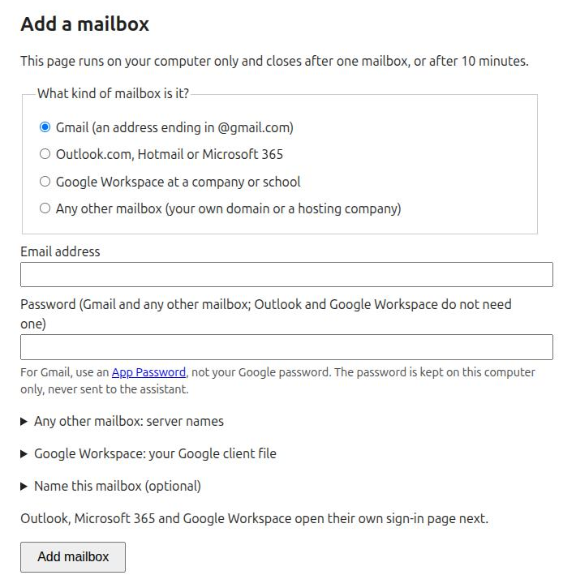

# Start here

Three steps, for any AI app. No terminal.

## 1. Install email-tool in your app

=== "Claude Desktop and Cowork"

    1. [Download email-tool](https://github.com/skhan61/email-tool/releases/latest/download/email-tool.mcpb).
       You get one file, `email-tool.mcpb`.
    2. Open the file (double-click it). Claude Desktop shows an install window.
    3. Leave every field blank and select **Install**.

    Claude Cowork uses what Claude Desktop installs, so it needs nothing more.

=== "ChatGPT desktop and Codex"

    1. Download the installer for your computer and open it:
        - **Windows:** [Install-email-tool.cmd](https://github.com/skhan61/email-tool/releases/latest/download/Install-email-tool.cmd).
          If Windows warns about a downloaded file, select **Run**, or **More info** and then
          **Run anyway**.
        - **macOS:** [Install-email-tool-macOS.zip](https://github.com/skhan61/email-tool/releases/latest/download/Install-email-tool-macOS.zip).
          Open the zip, then right-click **Install-email-tool.command** and select **Open**.
          macOS asks once because the file comes from the internet.
    2. When the installer says **Done**, open the ChatGPT desktop app and select **Plugins** >
       **Add Marketplace**. Type `skhan61/email-tool` and install **email-tool**.
    3. Close ChatGPT and open it again. Use **Work** or **Codex** mode; normal Chat does not
       reach tools on your computer yet.

=== "Claude Code"

    1. Install uv once with the installer for your computer (see the ChatGPT tab), or
       [by hand](install.md#install-uv-by-hand).
    2. In a terminal, add the marketplace and install the plugin:

        ```bash
        claude plugin marketplace add skhan61/email-tool
        claude plugin install email-tool@email-tool
        ```

        

        

        Or type the same inside Claude Code: `/plugin marketplace add skhan61/email-tool`,
        then `/plugin install email-tool@email-tool`.
    3. Close Claude Code and open it again.

=== "Another app"

    Any app that supports the Model Context Protocol (MCP) can run email-tool.
    See [Advanced setup](install.md#connect-through-a-configuration-file-or-command).

## 2. Add your mailbox

In your app, type:

> add my mailbox

A page opens in your browser. It runs on your computer only. If your app shows a link
instead, open the link.

{ width="560" }

1. Choose your kind of mailbox.
2. Type your email address.
3. Then, depending on the kind:
    - **Gmail:** type an App Password, not your Google password.
      [How to get an App Password](mailboxes.md#gmail).
    - **Outlook, Hotmail or Microsoft 365:** nothing more. After you select **Add mailbox**,
      Microsoft's sign-in page opens. Sign in and select **Accept**.
    - **Google Workspace at a company or school:** ask your IT department for the client file,
      or [create one](mailboxes.md#google-workspace).
    - **Any other mailbox:** type your password and, under **Any other mailbox: server names**,
      the server names from your provider.
4. Select **Add mailbox**. When the page says **Mailbox added**, go back to your app.

Your password never passes through the AI assistant. To add another mailbox, ask again.

## 3. Try it

- "Summarize my unread mail."
- "Draft a reply to the last message from Dana, with the report from my Downloads attached."
- "Send it." Your assistant asks you before it sends anything.

Something not working? See [Troubleshooting](troubleshooting.md).
